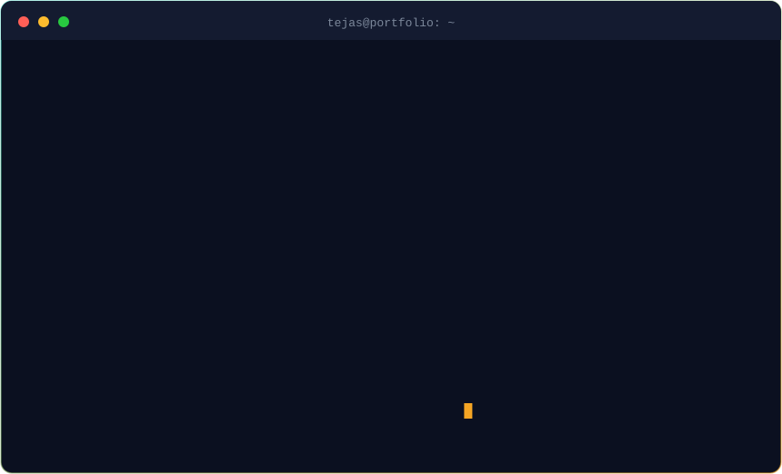

  

 

## Featured work

| Project | What it is | Stack |
| --- | --- | --- |
| **[FashionFlow AI](https://github.com/codedbytejas/fashionflow)** | Fashion-design SaaS for the Indian market: 2D canvas editor, Razorpay billing, OpenAI features | Next.js 15, TypeScript, Prisma, PostgreSQL |
| **[Job Application Portal](https://github.com/codedbytejas/Job-Application-Portal)** | Role-based hiring app: candidates upload PDF resumes, recruiters see only their own postings | React, Node, Express, MongoDB, JWT |
| **Mother Dairy D2C** | Direct-to-consumer store with row-level security, cart, payments and admin dashboard | Next.js 14, Supabase, Razorpay |
| **[CodeGraph](https://github.com/codegraph-org/CodeGraph)** | Open-source code-intelligence tool that visualises Stellar/Soroban codebases | TypeScript monorepo |
| **ArbMatrix** | Interactive Bellman-Ford visualiser that finds currency-arbitrage cycles | React, React Flow, Recharts |

## Open source and collaboration

- Maintainer on [codegraph-org/CodeGraph](https://github.com/codegraph-org/CodeGraph), with a scoped issue tracker and public roadmap
- Contributor to [Clearshift ERP](https://github.com/SamAltmanBT29/Clearshift-ERP), covering team delivery, pull requests and QA
- Contributor to [Sorolens](https://github.com/sorolens/sorolens), working on watchdog notification UX

## Tech stack

## Certifications

HackerRank: SQL (Basic, Intermediate, Advanced), Node.js (Basic, Intermediate), JavaScript (Basic, Intermediate) | AWS S3 Basic | Cisco Networking Basics

## Contribution activity

 

Learn, build, test, improve.

